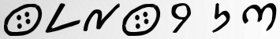
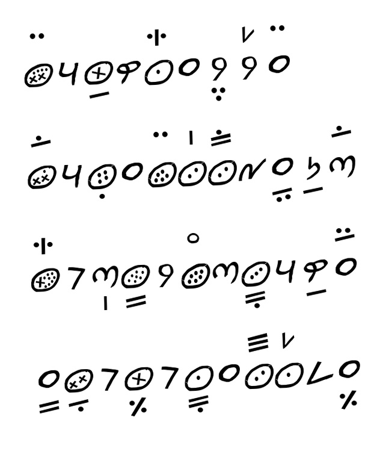
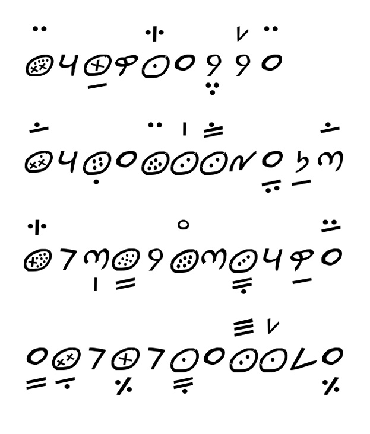
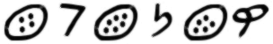
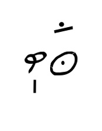
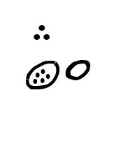
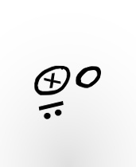
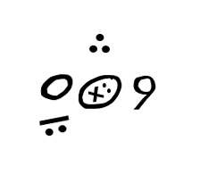
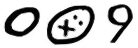

# Representative Stage2B failure examples

Full strings and all errors are in the CSV files. A missing prediction for a segmentation failure means inference was withheld, not an OCR deletion.

## all_000031__aug_01_shadow — blind / recognition

Cohort: general_unassigned_exploratory; augmentation: shadow. Structurally aligned tier differs from label; residual crop/warp effects may contribute.

Expected preview: `'mhimbfc'`

Prediction preview: `'mhmbfc'`

## all_000031__aug_01_shadow — assisted / recognition

Cohort: general_unassigned_exploratory; augmentation: shadow. Structurally aligned tier differs from label; residual crop/warp effects may contribute.

Expected preview: `'mhimbfc'`

Prediction preview: `'mhmbfc'`

## all_000228__aug_01_rotation — blind / segmentation

Cohort: general_unassigned_exploratory; augmentation: rotation. blind_overlapping_padded_bands

Expected preview: `"C   Q  IC\n+esdjabba\n  Z   U\n\nF   CJP   F\n(emankkiafc\n  X     RZ\n\nQ    N    D\n{gcpbocleda\n  ]_   S Z\n\n       KI\na'gsgjakjha\n_T W S    W"`

Prediction preview: `''`

## all_000228__aug_01_rotation — assisted / segmentation

Cohort: general_unassigned_exploratory; augmentation: rotation. assisted_overlapping_padded_bands

Expected preview: `"C   Q  IC\n+esdjabba\n  Z   U\n\nF   CJP   F\n(emankkiafc\n  X     RZ\n\nQ    N    D\n{gcpbocleda\n  ]_   S Z\n\n       KI\na'gsgjakjha\n_T W S    W"`

Prediction preview: `''`

## all_000228__aug_03_perspective — blind / segmentation

Cohort: general_unassigned_exploratory; augmentation: perspective. blind_overlapping_padded_bands

Expected preview: `"C   Q  IC\n+esdjabba\n  Z   U\n\nF   CJP   F\n(emankkiafc\n  X     RZ\n\nQ    N    D\n{gcpbocleda\n  ]_   S Z\n\n       KI\na'gsgjakjha\n_T W S    W"`

Prediction preview: `''`

## all_000228__aug_03_perspective — assisted / segmentation

Cohort: general_unassigned_exploratory; augmentation: perspective. assisted_overlapping_padded_bands

Expected preview: `"C   Q  IC\n+esdjabba\n  Z   U\n\nF   CJP   F\n(emankkiafc\n  X     RZ\n\nQ    N    D\n{gcpbocleda\n  ]_   S Z\n\n       KI\na'gsgjakjha\n_T W S    W"`

Prediction preview: `''`

## all_000548__aug_01_gaussian_blur — blind / recognition

Cohort: general_unassigned_exploratory; augmentation: gaussian_blur. Structurally aligned tier differs from label; residual crop/warp effects may contribute.

Expected preview: `'mgofnd'`

Prediction preview: `'ugofnd'`

## all_000548__aug_01_gaussian_blur — assisted / recognition

Cohort: general_unassigned_exploratory; augmentation: gaussian_blur. Structurally aligned tier differs from label; residual crop/warp effects may contribute.

Expected preview: `'mgofnd'`

Prediction preview: `'ugofnd'`

## all_003613__aug_02_perspective — blind / segmentation

Cohort: general_test_structure_match_exploratory; augmentation: perspective. blind_overlapping_padded_bands

Expected preview: `' F\ndj\n]'`

Prediction preview: `''`

## all_003613__aug_02_perspective — assisted / segmentation

Cohort: general_test_structure_match_exploratory; augmentation: perspective. assisted_overlapping_padded_bands

Expected preview: `' F\ndj\n]'`

Prediction preview: `''`

## edge_00032__aug_01_motion_blur — blind / segmentation

Cohort: positive_frozen_test; augmentation: motion_blur. blind_overlapping_padded_bands

Expected preview: `'A\nna\n'`

Prediction preview: `''`

## edge_00032__aug_02_jpeg — blind / segmentation

Cohort: positive_frozen_test; augmentation: jpeg. blind_overlapping_padded_bands

Expected preview: `'A\nna\n'`

Prediction preview: `''`

## edge_00033__aug_03_brightness — assisted / recognition

Cohort: positive_frozen_test; augmentation: brightness. Structurally aligned tier differs from label; residual crop/warp effects may contribute.

Expected preview: `'A'`

Prediction preview: `'U'`

## edge_00071__aug_02_perspective_shadow — assisted / segmentation

Cohort: positive_frozen_test; augmentation: perspective+shadow. assisted_overlapping_padded_bands

Expected preview: `'\nsa\nR'`

Prediction preview: `''`

## edge_00094__aug_02_rotation_jpeg — assisted / segmentation

Cohort: positive_frozen_test; augmentation: rotation+jpeg. assisted_overlapping_padded_bands

Expected preview: `' A\naub\nR'`

Prediction preview: `''`

## edge_00096__aug_01_rotation — assisted / recognition

Cohort: positive_frozen_test; augmentation: rotation. Structurally aligned tier differs from label; residual crop/warp effects may contribute.

Expected preview: `'aub'`

Prediction preview: `'atb'`

## edge_00302__aug_01_rotation — blind / recognition

Cohort: positive_frozen_test; augmentation: rotation. Structurally aligned tier differs from label; residual crop/warp effects may contribute.

Expected preview: `'J'`

Prediction preview: `']'`

