# Stage2C selected-candidate before/after examples

These are offline evaluation overlays. Blue boxes are accepted proposals, not guaranteed correct segmentation. Per-page status is stated below. Full-resolution and left/right detail images are saved for dot/stroke inspection.

## general / all_000920__aug_01_resolution_jpeg / correct

Partition: validation; augmentation: resolution+jpeg. C4 reason: reference geometry passed.

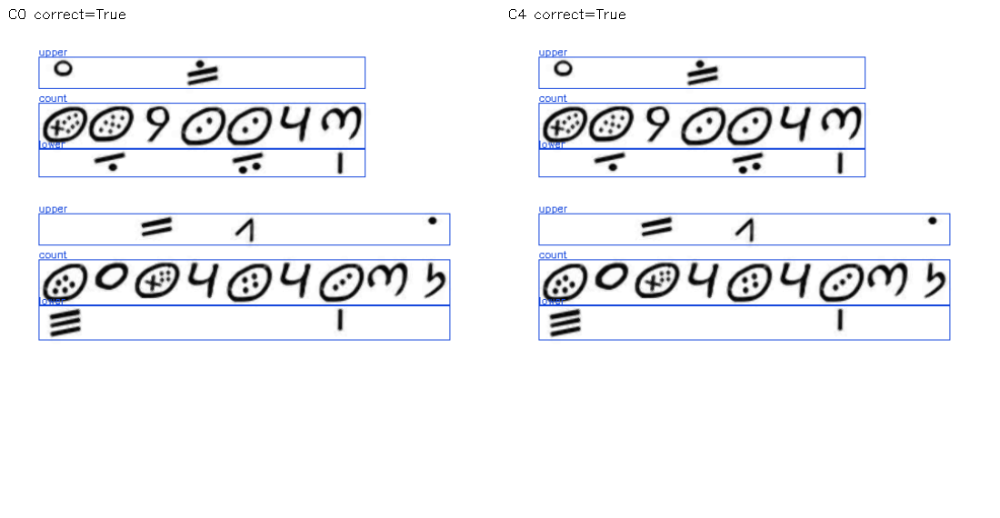

## normal / train_035170__clean / correct

Partition: clean_regression; augmentation: clean. C4 reason: reference geometry passed.

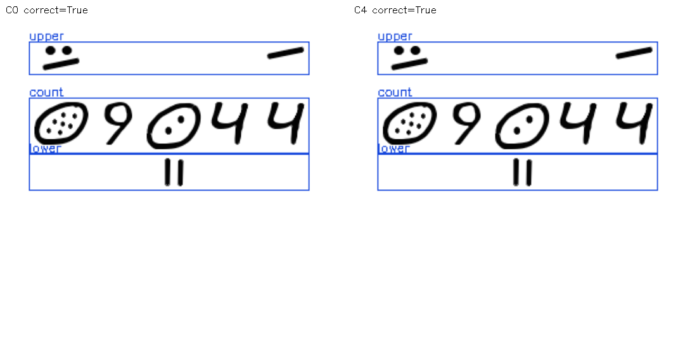

## positive / edge_00242__aug_03_jpeg / recovered

Partition: validation; augmentation: jpeg. C4 reason: reference geometry passed.

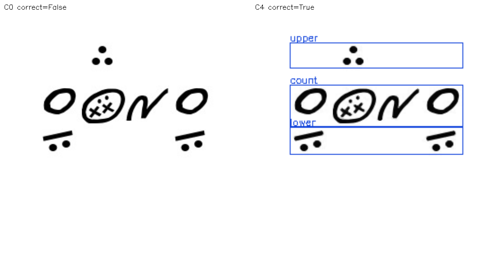

## positive / edge_00270__clean / wrong_acceptance

Partition: validation; augmentation: clean. C4 reason: tier_role_or_grouping_mismatch.

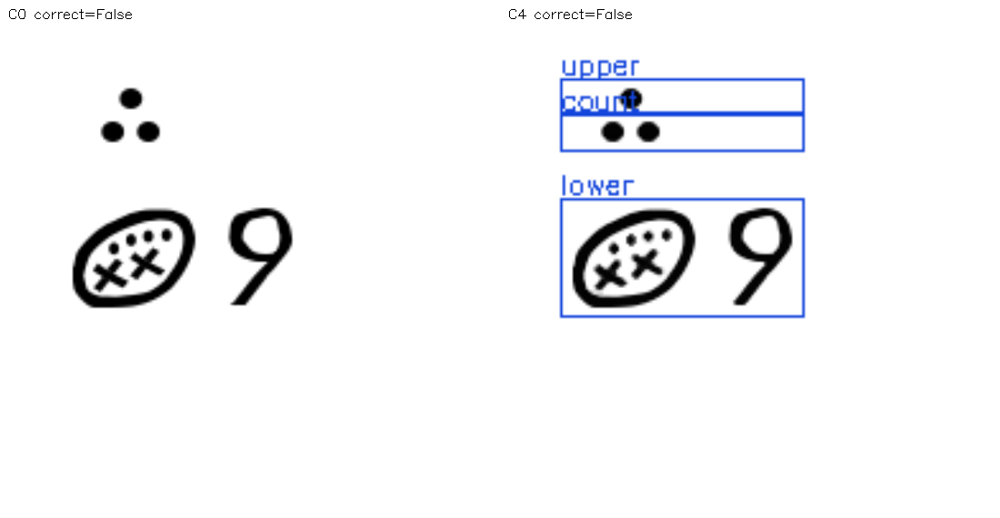

## positive / edge_00262__clean / rejection

Partition: validation; augmentation: clean. C4 reason: no_valid_row_grammar.

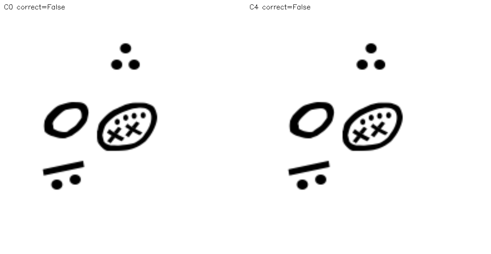

## general / all_006708__aug_01_perspective_shadow / recovered

Partition: validation; augmentation: perspective+shadow. C4 reason: reference geometry passed.

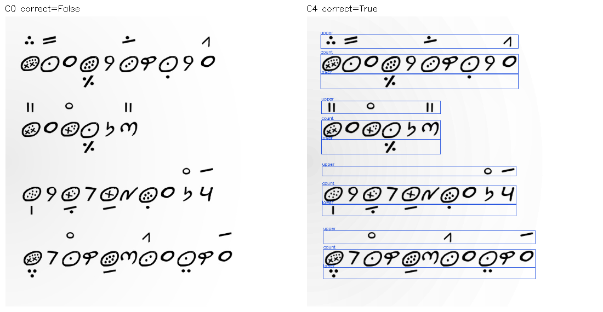

## positive / edge_00039__aug_01_jpeg / wrong_acceptance

Partition: validation; augmentation: jpeg. C4 reason: row_count_mismatch.

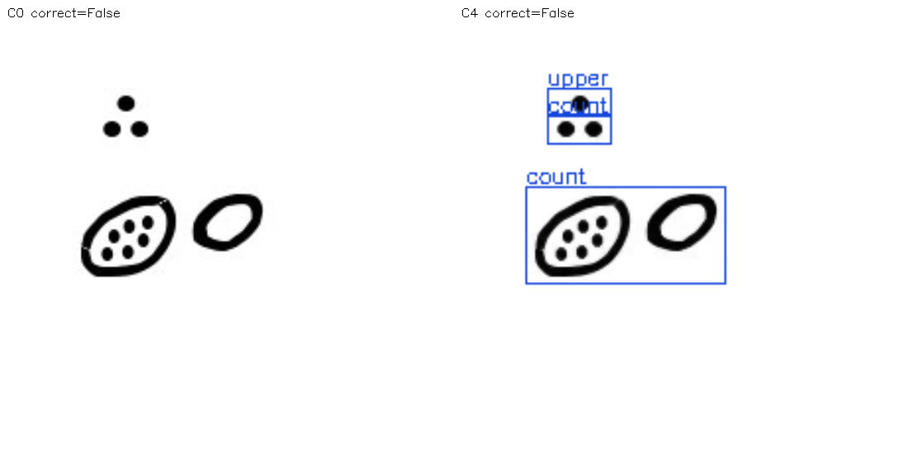

## general / all_008607__clean / correct

Partition: validation; augmentation: clean. C4 reason: reference geometry passed.

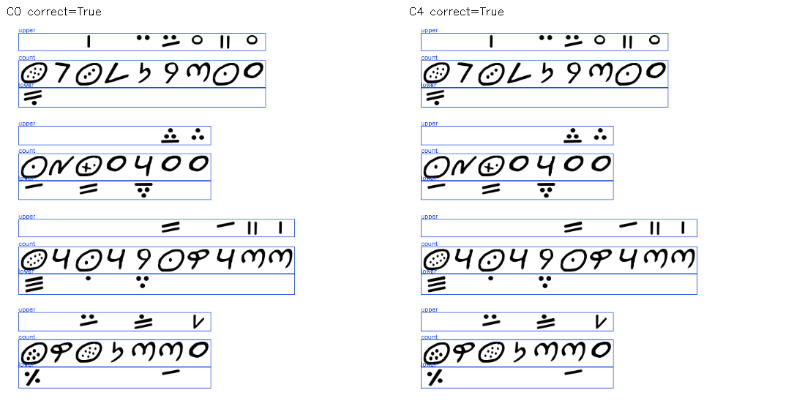

## positive / edge_00049__aug_03_noise / regression

Partition: validation; augmentation: noise. C4 reason: tier_role_or_grouping_mismatch.

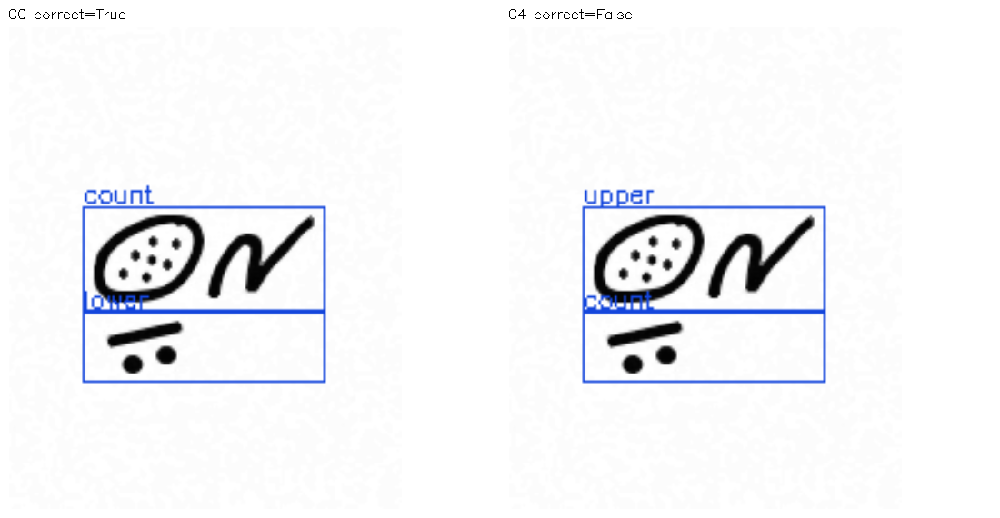

## positive / edge_00238__aug_02_rotation_jpeg / correct

Partition: validation; augmentation: rotation+jpeg. C4 reason: reference geometry passed.

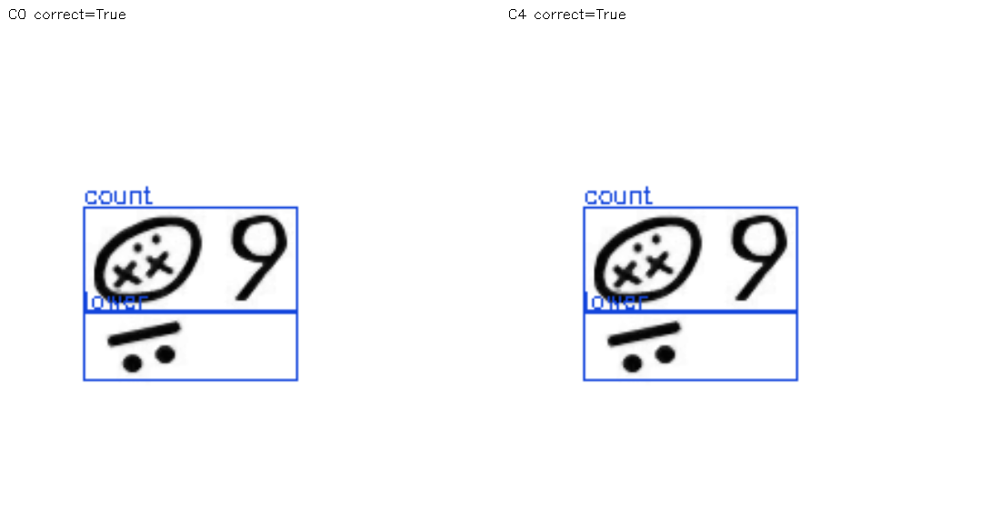

## normal / train_063509__clean / recovered

Partition: clean_regression; augmentation: clean. C4 reason: reference geometry passed.

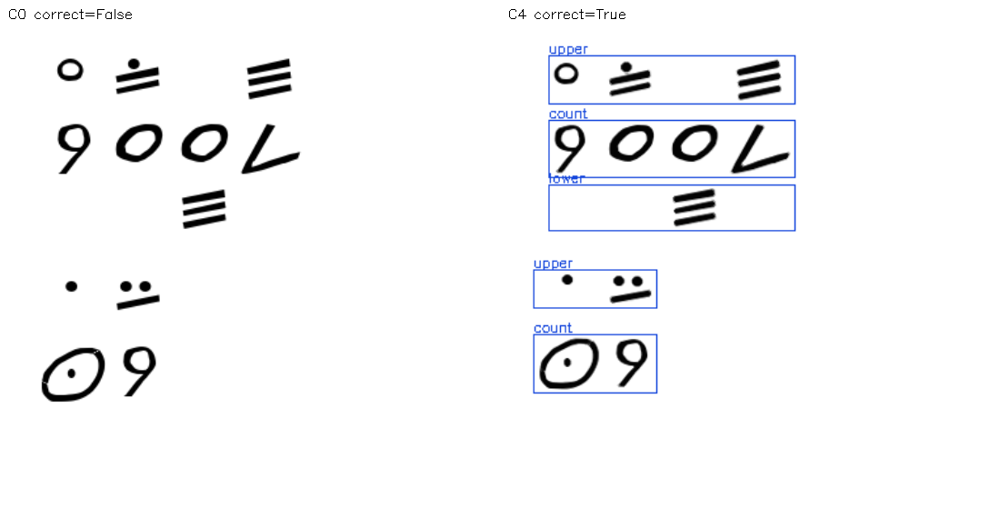

## general / all_006677__aug_03_rotation_jpeg / wrong_acceptance

Partition: validation; augmentation: rotation+jpeg. C4 reason: tier_role_or_grouping_mismatch.

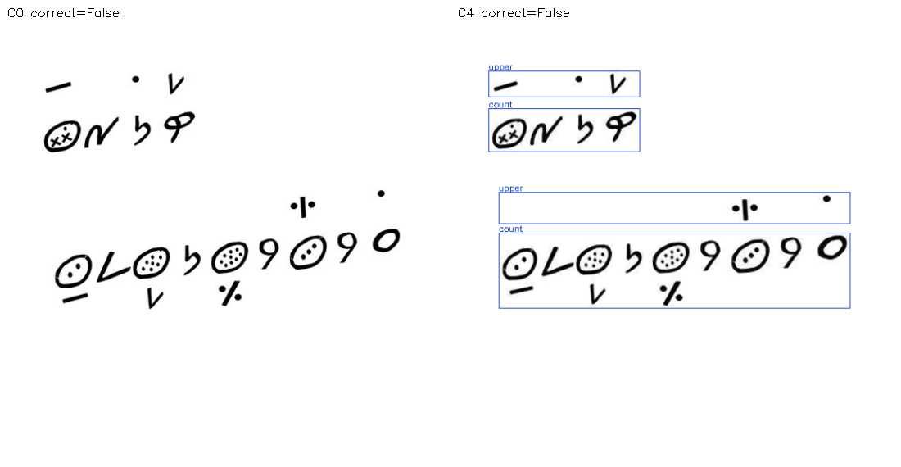

## positive / edge_00326__clean / long_dense_wrong_acceptance

Partition: tuning; augmentation: clean. C4 reason: row_count_mismatch.

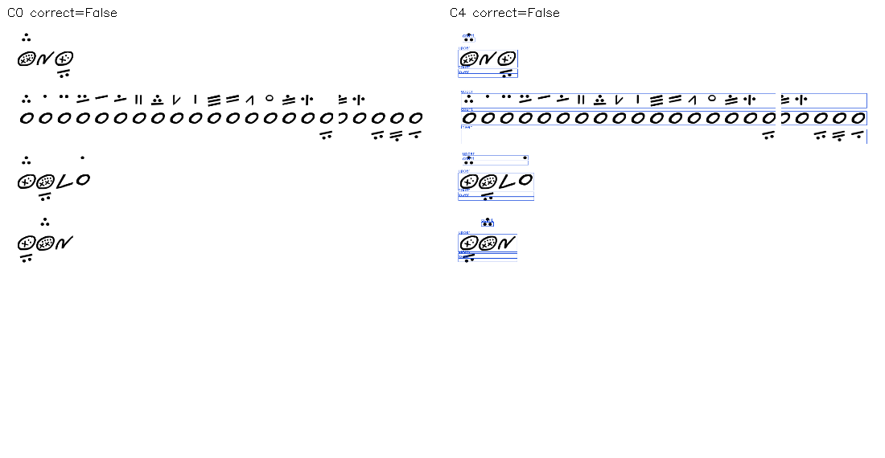

## positive / edge_00002__clean / recovered

Partition: validation; augmentation: clean. C4 reason: reference geometry passed.

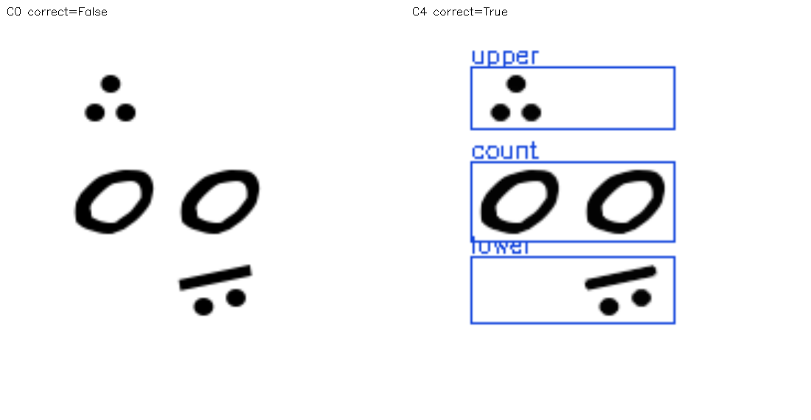

## positive / edge_00324__aug_02_resolution / long_dense_recovered

Partition: tuning; augmentation: resolution. C4 reason: reference geometry passed.

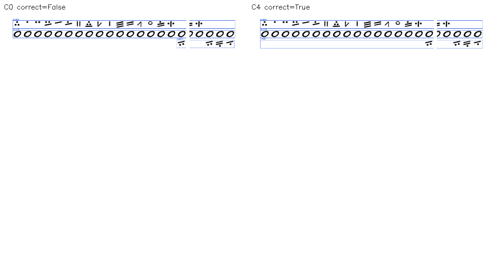

## positive / edge_00016__clean / correct

Partition: validation; augmentation: clean. C4 reason: reference geometry passed.

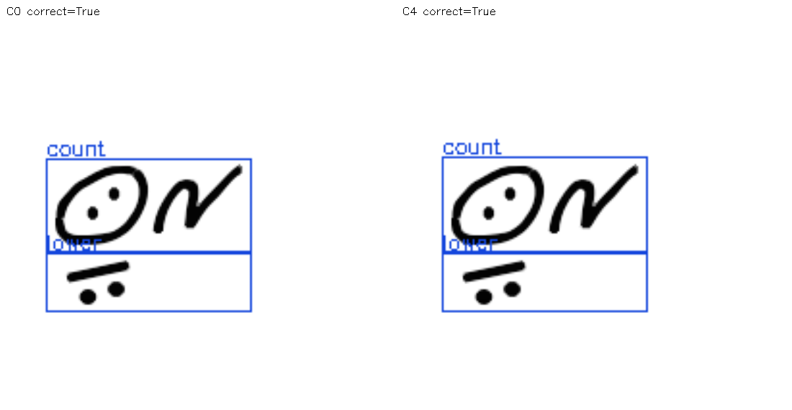

## positive / edge_00193__clean / regression

Partition: validation; augmentation: clean. C4 reason: tier_role_or_grouping_mismatch.

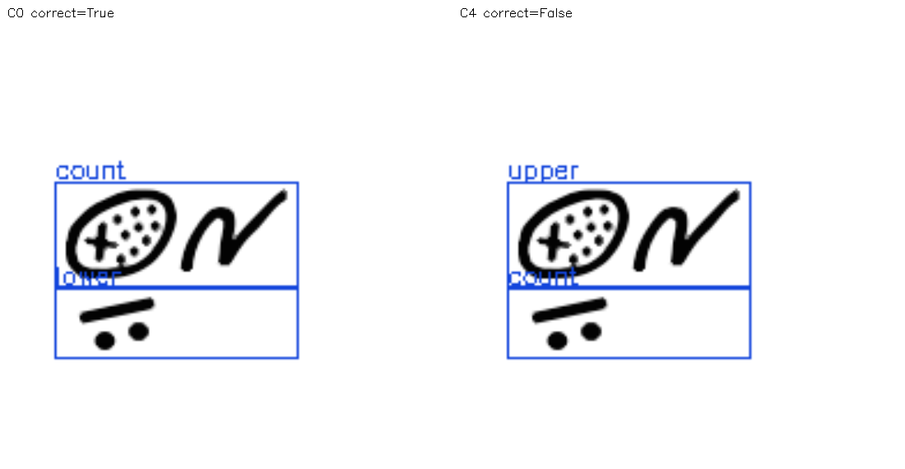

## general / all_007085__clean / regression

Partition: validation; augmentation: clean. C4 reason: tier_role_or_grouping_mismatch.

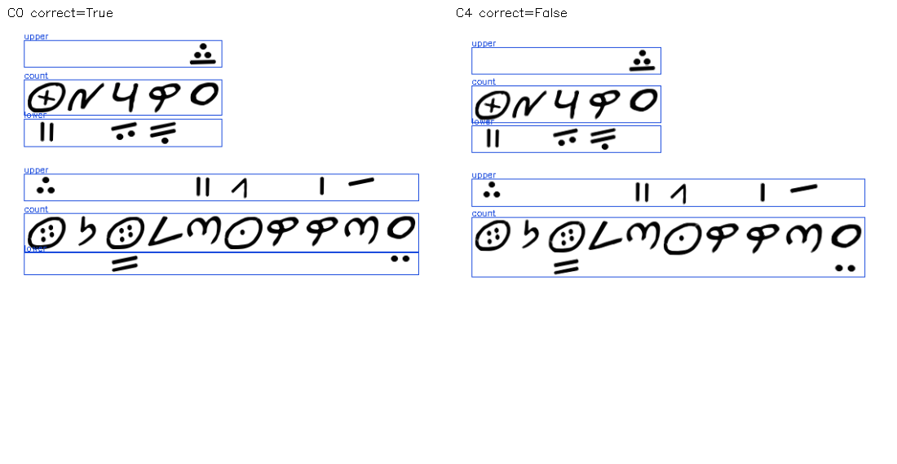

## positive / edge_00324__clean / long_dense_recovered

Partition: tuning; augmentation: clean. C4 reason: reference geometry passed.

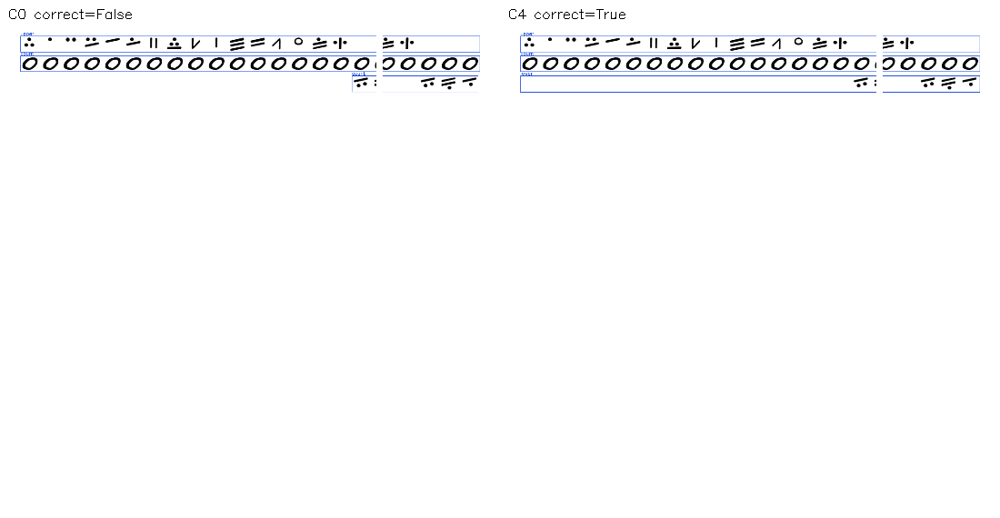

## general / all_005202__clean / recovered

Partition: validation; augmentation: clean. C4 reason: reference geometry passed.

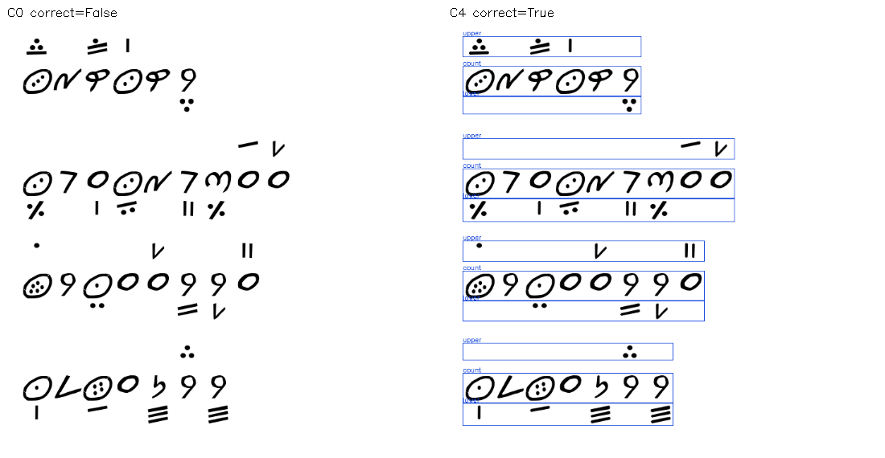
